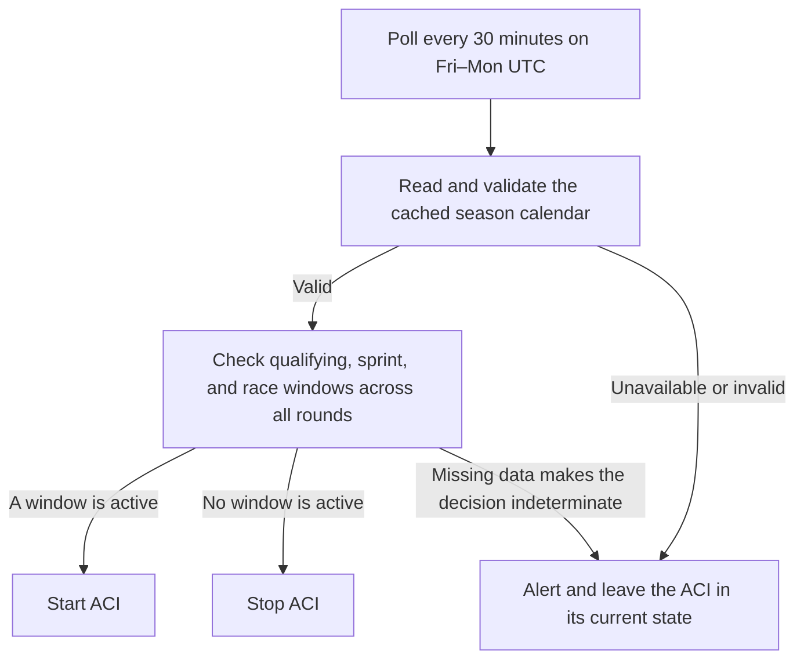

# F1 Fantasy ACI Scheduler — Logic App

Polls every 30 minutes on **Fri/Sat/Sun/Mon** and idempotently starts or stops the ACI based on F1 session time windows.

## Flow



## Session Time Windows

Each session defines a window during which the ACI should be running:

| Session    | Window Start          | Window End            | Notes                         |
| ---------- | --------------------- | --------------------- | ----------------------------- |
| Qualifying | `quali_time - 30min`  | `quali_time + 90min`  | 1.5h total from session start |
| Sprint     | `sprint_time - 30min` | `sprint_time + 90min` | 1.5h total from session start |
| Race       | `race_time - 30min`   | `race_time + 240min`  | 4h after session start        |

- Sprint windows apply on sprint weekends.
- All times are **UTC**.

## Example — Miami GP 2026 (Sprint Weekend)

| Session    | Start (UTC) | ACI Start | ACI Stop  |
| ---------- | ----------- | --------- | --------- |
| Qualifying | Sat 20:00   | Sat 19:30 | Sat 21:30 |
| Sprint     | Sat 16:00   | Sat 15:30 | Sat 17:30 |
| Race       | Sun 20:00   | Sun 19:30 | Mon 00:00 |

## Key Design Decisions

- **Idempotent:** Starting an already-running ACI or stopping an already-stopped ACI is a no-op.
- **Polling over scheduling:** Avoids Logic App `Delay Until` complexity; self-corrects on every run.
- **Managed Identity auth:** Logic App uses system-assigned identity to call Azure Management API.

## Deployment

```bash
az deployment group create \
  --resource-group f1-fantazy-bot \
  --template-file azuredeploy.json \
  --parameters azuredeploy.parameters.json
```

Routine deployments reuse the scheduler’s existing Blob Data Reader grant.
For a new scheduler identity, run the deployment above once with
`grantCalendarReader=true` appended to the `--parameters` line, using an Azure
identity that can assign roles on the blob container. Assign ACI access
separately.

```bash
az role assignment create \
  --assignee <logicAppPrincipalId> \
  --role Contributor \
  --scope /subscriptions/<subId>/resourceGroups/f1-fantazy-bot/providers/Microsoft.ContainerInstance/containerGroups/f1-fantasy-live-score-aci
```

## Data Source

The scheduler reads `jolpica/calendar.json` with its system-assigned identity.
The deployment grants Storage Blob Data Reader on the existing blob container.
It checks every round and leaves the ACI in its current state if reading or
validating the calendar fails, or a missing session time makes the decision
indeterminate.
